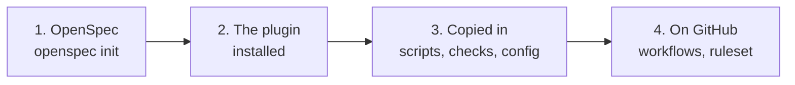

# Governed delivery with Claude Code

A small codebase, and the Claude Code setup that governs how changes to it are made. [OpenSpec](https://github.com/Fission-AI/OpenSpec)
says what to build: a change with a proposal, tasks, and requirements with scenarios. Around it, this
repository adds how it gets built: a coordinator command that delivers a change end to end, subagents that
read on a cheaper model and cannot write, a reviewer that is never told the author's reasons, hooks and
checks that enforce what prompts can only ask for, and a plugin that carries it to another repository. It is
built for a team: a brief starts as a GitHub issue, its change is refined in a reviewed pull request, several
people can deliver at once, each in a folder of their own, and pull requests are the only way into `main`.

The codebase itself, Ticketdesk, is deliberately small: the rules a support desk uses to set a ticket's
priority and its response deadline in business hours. It is there so the workflow has something real to
govern.

## The history is the point

Each stage is a branch merged into `main`, and each merge message is written like a pull request: In plain
terms, What changed, Tests, Review findings. The stages are in the order the problems showed up, and each
one exists because the stage before it left something unguarded.

```bash
git log --first-parent --reverse --format='%h %s' main   # the stages
git log --graph --format='%h %s%n%b' main                # everything, with the reasons
```

| # | Stage | The problem it answers |
|---|---|---|
| 1 | Start with a plain `CLAUDE.md` | (none yet) |
| 2 | `headless-agent` | Specified work waits for someone to sit in a session |
| 3 | `lessons-from-unattended-runs` | An unwatched run can believe it succeeded when it has not; the script trusted its report |
| 4 | `enforce-not-describe` | Lessons written as prose are followed most of the time, and `CLAUDE.md` only grows |
| 5 | `deliver-command` | Two definitions of how a specification gets built, and reading fills the builder's context |
| 6 | `missing-gates` | Two deliveries at once, defects fixed without being reproduced, criteria reworded to fit the code |
| 7 | `independent-review` | The author is the worst-placed reviewer, and an explained change gets reviewed as explained |
| 8 | `read-only-hook` | "Reads only" was a sentence in a prompt, and Bash reaches everything |
| 9 | `parallel-survey` | The builder discovered the code's shape halfway through building |
| 10 | `package-as-plugin` | The workflow could not travel, and a plugin's subagents ignore `hooks` |
| 11 | `headless-permissions` | An unattended run would have been refused the commands its own gates use |
| 12 | `spec-reader-without-a-shell` | The read-only hook kept needing fixes to model git, for a shell the spec-reader did not need |
| 13 | `team-delivery` | Everything assumed one person on one machine: one delivery at a time, a local main, no pull requests |
| 14 | `openspec` | A home-made spec format and numbering, with no refinement step, where an established framework does the job |
| 15 | `first-delivery` | Everything had been tested against stand-ins; nothing had yet delivered a change for real, on GitHub, with nobody watching |
| 16 | `refinement-on-github` | Every change had been refined before the repository reached GitHub; none had started as a brief in an issue |
| 17 | `overnight-delivery` | The delivery started by a label had never run, so nothing showed it could deliver with nobody's machine involved |

Some findings in the history came from checking the checks. The first UTC gate could not fail (`grep`
given a directory without `-r`). With the hook's character scan disabled every hook test still passed, so
none depended on it. `git grep -O`, which starts a program, got through the reviewer's allowlist. Its fix
checked how an argument began, so the spec-reader still let `-iOvim` and `--open=vim` through: git reads
short options in bundles and accepts any unambiguous prefix of a long one. Each is in the commit that fixed
it. The last fix was to stop patching: the spec-reader lost its shell, and the profile that kept needing
fixes went with it (stage 12).

## What it demonstrates

| Area | Where to look |
|---|---|
| **CLAUDE.md at three levels**: project, directory (loaded on demand), and a rule as a pointer at its check | [`CLAUDE.md`](CLAUDE.md), [`src/CLAUDE.md`](src/CLAUDE.md), [ADR 0001](docs/adr/0001-a-rule-points-at-what-enforces-it.md) |
| **Coordinator and subagents**: one command running a lifecycle, with grounding delegated | [`deliver.md`](.claude/commands/deliver.md), [ADR 0002](docs/adr/0002-reading-is-delegated-to-a-subagent.md) |
| **Parallel subagents with isolated context**: spec-reader and Explore in one message | [`deliver.md` step 1](.claude/commands/deliver.md) |
| **Model routing**: reading on Sonnet, review on the session's model | [`spec-reader.md`](.claude/agents/spec-reader.md), [`independent-reviewer.md`](.claude/agents/independent-reviewer.md) |
| **Review without the author's rationale**, pinned to one commit | [`independent-reviewer.md`](.claude/agents/independent-reviewer.md), [ADR 0003](docs/adr/0003-the-reviewer-is-not-told-why.md) |
| **A tool list instead of a guard**: the spec-reader has no shell, so nothing needs to hold it | [`spec-reader.md`](.claude/agents/spec-reader.md), [ADR 0006](docs/adr/0006-an-agent-that-can-do-without-a-shell-gets-none.md) |
| **PreToolUse hooks that fail closed**, scoped to one subagent, with their own tests | [`read_only_bash.py`](.claude/hooks/read_only_bash.py), [tests](.claude/hooks/test_read_only_bash.py), [ADR 0004](docs/adr/0004-a-restriction-is-a-hook-not-a-sentence.md) |
| **Permissions**: allow and deny rules for the project | [`.claude/settings.json`](.claude/settings.json) |
| **Headless Claude Code**: `claude -p`, JSON output, an allowlist of tools, a turn limit, the build as the judge | [`scripts/agent.sh`](scripts/agent.sh) |
| **Plugin and marketplace**, generated from the project, validated, with a drift check | [`plugin/`](plugin), [`package_plugin.py`](tools/package_plugin.py), [ADR 0005](docs/adr/0005-the-plugin-is-generated-from-the-project.md) |
| **Specs with an established framework**: OpenSpec changes and specs, its own checks (`validate`, `validate --archived`, the `verify` workflow), and one check of ours: every scenario has a test | [`openspec/`](openspec), [`specs.mjs`](tools/specs.mjs), [tests](tools/specs.test.js), [ADR 0008](docs/adr/0008-specs-are-openspec-changes.md) |
| **Refinement as a pull request**: a change reaches main only through review, and its issue is then labelled ready | [`refined.yml`](.github/workflows/refined.yml), [ADR 0008](docs/adr/0008-specs-are-openspec-changes.md) |
| **Worked examples in Gherkin**: every scenario of a change is an outline with examples a person on the desk can check, and the build checks the outline | [`specs.mjs`](tools/specs.mjs), [ADR 0009](docs/adr/0009-a-scenario-is-an-outline-with-worked-examples.md) |
| **Risk and revisions in OpenSpec's own config**: every proposal states a risk, medium or high ones get mitigations, and requirements revised during delivery are flagged for a person to confirm | [`openspec/config.yaml`](openspec/config.yaml), [an example change](openspec/changes/archive/2026-11-13-2-public-holidays) |
| **A team, the way Git works**: a folder per delivery, starting offline, one issue per change saying who has it, one step that assigns and checks that only look | [`start-delivery.sh`](scripts/start-delivery.sh), [`claim-delivery.sh`](scripts/claim-delivery.sh), [`finish-delivery.sh`](scripts/finish-delivery.sh), [tests](tools/delivery.test.js), [ADR 0007](docs/adr/0007-a-team-delivers-the-way-git-works.md) |
| **CI on GitHub**: the build and the ownership check on every pull request, and unattended deliveries started by a label | [`build.yml`](.github/workflows/build.yml), [`deliver.yml`](.github/workflows/deliver.yml) |
| **Human gates**: a change is not ready until its pull request is approved; nothing merges without one | [`deliver.md` step 6](.claude/commands/deliver.md), branch protection (below) |

## Run it

Needs Node 22.12 or later and Python 3. The build installs OpenSpec, pinned in `package.json`, if it is
missing.

```bash
./build.sh
```

The build is the whole gate: syntax, the UTC rule, OpenSpec's own validation (including that nothing is
archived half-done), that OpenSpec's verify skill is installed, scenario coverage, the tests, the plugin's
drift check, and the hook's tests.

OpenSpec's skills in a Claude Code session (`/openspec-propose` and the others) run the `openspec` command, so
install the same version for your machine:

```bash
npm install --global @fission-ai/openspec@2.0.0
```

The change `2-public-holidays` (issue #2) has already been delivered this way, unattended: the change is in
[its archive](openspec/changes/archive/2026-11-13-2-public-holidays), and its commits are the ones titled
`2-public-holidays: …` in this history. To see the workflow work on a change of your own, propose one with
`/openspec-propose <what you want>`, named after its issue (`57-bank-holidays`), and once it is approved:

```bash
./scripts/agent.sh 57                  # unattended: its own folder, /deliver run headless, then the build
```

or start it by hand and work in the folder it prints, in a Claude Code session:

```bash
./scripts/start-delivery.sh 57                 # then, in that folder: /deliver 57-bank-holidays
./scripts/finish-delivery.sh                   # from that folder, once /deliver has finished
```

## Setting it up for a team

1. Put the repository on GitHub. Add a ruleset for `main` that requires a pull request, one approval, the
   `build` and `claimed` checks, and branches to be up to date before merging. On a private repository
   that needs GitHub Pro or a team plan. With one person, set approvals to 0 until there is a second
   person or a delivery bot whose pull requests need your review.
2. Everyone sets OpenSpec's workflows to include `verify`, once per machine, so `openspec update` keeps it:

   ```bash
   openspec config set workflows '["propose","explore","apply","update","sync","archive","verify"]'
   openspec config set profile custom
   ```

3. Start every piece of work as a GitHub issue with a brief. Propose its change on a branch, named after the
   issue (`57-bank-holidays`), and open a pull request: that is the refinement. Once it is approved and
   merged, the change is ready and the `refined` workflow labels the issue `ready`. Whoever the issue is
   assigned to has the work.
4. For deliveries on GitHub's machines (the `deliver` label), add the secret `ANTHROPIC_API_KEY`, a bot
   account's token as the secret `DELIVERY_TOKEN`, and that account's login as the variable `DELIVERY_BOT`.
   [`deliver.yml`](.github/workflows/deliver.yml) says why each is needed.

## Using it in another project

The plugin carries the part that is Claude Code: `/deliver`, the spec-reader, the independent reviewer,
and the hook that holds the reviewer to read-only commands. Everything else is the project's own, and is
copied in.



1. **OpenSpec.** Install the version this repository pins (2.0.0), run `openspec init --tools claude`, and
   switch on its `verify` workflow as in "Setting it up for a team", step 2.
2. **The plugin.** From a clone of this repository:

   ```bash
   claude plugin marketplace add ./plugin
   claude plugin install governed-delivery@governed-workflow
   ```

3. **Copied in, and fitted to the project:**

   | Copy | What it does | Fit it |
   |---|---|---|
   | [`scripts/`](scripts) | starts, claims and finishes a delivery; `agent.sh` runs one unattended | as they are, if the gate is `./build.sh` and changes are named after issues: `agent.sh` allows only the build, `openspec` and git |
   | [`tools/specs.mjs`](tools/specs.mjs) | fails the build when a scenario has no test, or an open change's scenario is not an outline with examples | tests must name the scenario they cover in their title, as here |
   | [`tools/links.mjs`](tools/links.mjs) | fails the build on a broken relative link | as it is |
   | [`openspec/config.yaml`](openspec/config.yaml) | the rules on risk, worked examples and revisions | the risk rule names what is risky for the desk (a deadline, a priority); reword it for yours |
   | [`build.sh`](build.sh) | the whole gate, which `/deliver` runs before every commit | keep the OpenSpec, scenario and link checks; replace the rest with your own |

4. **On GitHub:** copy [`.github/workflows/`](.github/workflows) and [`scripts/approved-issues.sh`](scripts/approved-issues.sh),
   and add the ruleset and secrets as in "Setting it up for a team".

Then each change follows the same path as here: an issue, `/openspec-propose` named after it, its pull
request merged, `scripts/start-delivery.sh`, `/deliver` in the folder it makes, `scripts/finish-delivery.sh`.

The plugin has not yet been installed into another project for real (below); its manifests pass
`claude plugin validate --strict`, and the build checks it matches `.claude/`.

## What has and has not been verified

- **Verified by the build:** every gate, each shown failing on a planted breach before it was trusted;
  the hook's allow and refuse lists, its agent-type mode and its failure handling; each read-only agent's
  tool list; the plugin matching a fresh build of `.claude/`.
- **Verified against a stand-in team:** starting, claiming, finishing and an unattended run, with a shared
  repository on disk and pretend `gh` and `claude` commands ([`tools/delivery.test.js`](tools/delivery.test.js)):
  offline starts, a second person starting the same change, a refused assignment, two people on one issue,
  a change not yet archived, and a run in CI for the person assigned.
- **Verified against OpenSpec 2.0.0 itself:** the specs and the change pass `openspec validate --strict`,
  and archiving the change in a throwaway copy updated the main spec as the scripts expect; archiving it with
  tasks undone made `validate --archived` fail; `openspec instructions` returns the project's risk rules and
  its build and archive guidance.
- **Verified by `claude plugin validate --strict`:** the marketplace and plugin manifests.
- **Run for real, headless** (13 November 2026, `./scripts/agent.sh 2`, 13 minutes, on a Pro subscription,
  which counted it as $3.50 of use): `/deliver` took issue #2 from its approved change to a draft pull
  request whose `build` and `claimed` checks passed, on the repository's first copy (below); its commits are
  the ones titled `2-public-holidays: …`. It wrote each scenario's test before the code;
  the spec-reader and the reviewer ran as subagents, and the reviewer's hook refused it `node`; OpenSpec's
  apply and verify skills ran; the change was archived, and the one thing it added beyond the spec was put
  first in the pull request for a person to confirm. What it taught, and what changed:
  - the reviewer needed four rounds, the first finding a real regression and the last about inputs nobody
    sends, so `/deliver` now reviews at most twice and leaves later findings to a person;
  - the first attempt failed on an expired login and left an empty folder that blocked the second, so a
    run that fails before committing now removes its folder and branch;
  - `acceptEdits` let unlisted file commands run, `rm` among them, so the run now uses `dontAsk`, which
    refuses them; an in-place `sed -i` still runs unlisted under both, which `agent.sh` says.
  - its scenarios were rules nobody on the desk could check at a glance, so every scenario of a change is
    now a Gherkin outline with worked examples (ADR 0009); change 2's were rewritten so, each row was
    tested against the delivered code, and the delivery was merged.
- **Not yet verified in a live session:** the packaged plugin's hook, and a delivery under the two-review
  limit and `dontAsk`.
- **Run on GitHub** (13 November 2026, with a ruleset on `main` requiring a pull request and both checks).
  The repository was recreated once its history was final, so the issues and pull requests of its first
  copy are gone; issue #1 says so.
  - `build` passes on every push and pull request, and merging was refused while it was still running;
  - `refined`, on the first copy: it labelled issue #2 `ready` when its change, renamed to
    `2-public-holidays`, was merged. The first attempt would have missed a renamed change; the fix came
    first, in `scripts/approved-issues.sh`, with its tests in `tools/approved-issues.test.js`;
  - `claimed`, on this copy, on a trial delivery pull request (#3, closed unmerged): it failed while issue
    #2 was unassigned, and the ruleset refused the merge; once the issue was assigned it passed, using the
    real `gh` through `claim-delivery.sh --check`.
- **Refined on GitHub** (13 November 2026): OpenSpec's `propose` skill, headless, wrote change
  `4-security-reports-are-urgent` from the brief in issue #4, in 20 turns. Its pull request (#5) was
  reviewed and merged, and `refined` labelled the issue `ready`.
- **Delivered overnight on GitHub** (14 November 2026, the `deliver` workflow, started by labelling issue #4
  `deliver`; 5 minutes, 66 turns, $2.04 of API use): the run delivered the change on GitHub's machines and
  opened draft pull request #6, whose `build` and `claimed` checks passed. Its commits are credited to the
  person assigned, at their no-reply address. The token was the owner's own fine-grained token, standing in
  for a bot account, so `claimed` checked the pull request's author. The reviewer took one round. What it
  found:
  - the delivery tests handed their stand-in team the real `DELIVERY_FOR`, so every delivery on GitHub
    failed its own build before it could push. It fixed the tests, outside the proposal, and put that first
    in the pull request for a person to accept; it was accepted;
  - the links check listed files with `git ls-files`, so after `openspec archive` it crashed on the moved
    change until the move was staged. It now checks the files where they are.
- **Not yet run on GitHub:** a delivery under a separate bot account, and required approvals, which need a
  second person.
- **Not yet used in a session:** OpenSpec's `explore` skill, and the archive guidance's "please confirm the
  intent" question, which only an attended delivery asks.

## Layout

```
.claude/
  agents/        spec-reader, independent-reviewer
  commands/      deliver
  hooks/         read_only_bash.py and its tests
  skills/        links to OpenSpec's skills
  settings.json  permissions
.agents/skills/  OpenSpec's skills, shared by any AI tool (generated by openspec init and update)
docs/adr/        why each decision was made
openspec/
  specs/         how the system works now, requirement by requirement
  changes/       approved changes still to deliver, and archive/ for delivered ones
.github/         the build and claimed checks, the ready label, and deliveries started by a label
plugin/          a marketplace with one plugin, generated from .claude/
scripts/         start, claim and finish a delivery; agent.sh runs one unattended
src/, test/      Ticketdesk and its tests
tools/           specs.mjs, package_plugin.py, and the stand-in gh and claude for tests
build.sh         the gate
```
