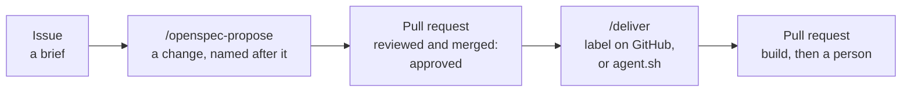
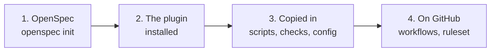

# Governed delivery with Claude Code

A small codebase, and the Claude Code setup that governs how changes to it are made. [OpenSpec](https://github.com/Fission-AI/OpenSpec)
says what to build: a change with a proposal, tasks, and requirements with scenarios. Around it, this
repository adds how it gets built: a coordinator command that delivers a change end to end, subagents that
read on a cheaper model and cannot write, a reviewer that is never told the author's reasons, hooks and
checks that enforce what prompts can only ask for, and a plugin that carries it to another repository. On
GitHub it works the standard way: a brief starts as an issue, its change is refined in a reviewed pull
request, a label hands it to Anthropic's Claude Code action, and pull requests are the only way into `main`.

The codebase itself, Ticketdesk, is deliberately small: the rules a support desk uses to set a ticket's
priority and its response deadline in business hours. It is there so the workflow has something real to
govern, and its rules are shared, as worked examples, with two C# services in sibling repositories.

## How a change gets made



`/deliver` itself, in order ([`deliver.md`](.claude/commands/deliver.md)):

1. **Gates.** The change is on main (approved); the session is on a branch of its own; a defect is reproduced
   by a failing test before it is fixed; requirements are revised only while their intent holds.
2. **Grounding, in parallel.** The `spec-reader`, with no shell, returns every requirement and scenario word
   for word; `Explore` surveys the code they touch.
3. **Building**, through OpenSpec's apply step: a test named after every scenario, written first, and
   `./build.sh` before every commit.
4. **Independent review**, by a reviewer given one commit and the test citations, and nothing else.
5. **OpenSpec's verify**, then **archive**, which folds the change into the main specs, listing any
   requirement revised since approval for a person to confirm.
6. **A pull request description**, with the risk, the revisions and every review finding.

## What it demonstrates

| Area | Where to look |
|---|---|
| **CLAUDE.md at three levels**: project, directory (loaded on demand), and a rule as a pointer at its check | [`CLAUDE.md`](CLAUDE.md), [`src/CLAUDE.md`](src/CLAUDE.md), [ADR 0001](docs/adr/0001-a-rule-points-at-what-enforces-it.md) |
| **Coordinator and subagents**: one command running a lifecycle, with grounding delegated | [`deliver.md`](.claude/commands/deliver.md), [ADR 0002](docs/adr/0002-reading-is-delegated-to-a-subagent.md) |
| **Parallel subagents with isolated context**: spec-reader and Explore in one message | [`deliver.md` step 1](.claude/commands/deliver.md) |
| **Model routing**: reading on Haiku, review on the session's model, and deliveries on GitHub on Sonnet with a dollar cap | [`spec-reader.md`](.claude/agents/spec-reader.md), [`independent-reviewer.md`](.claude/agents/independent-reviewer.md) |
| **Review without the author's rationale**, pinned to one commit, at most two rounds | [`independent-reviewer.md`](.claude/agents/independent-reviewer.md), [ADR 0003](docs/adr/0003-the-reviewer-is-not-told-why.md) |
| **A tool list before a guard, and a guard that fails closed**: the spec-reader has no shell; the reviewer's Bash is held by a PreToolUse hook scoped to it, with its own tests | [`spec-reader.md`](.claude/agents/spec-reader.md), [`read_only_bash.py`](.claude/hooks/read_only_bash.py), [tests](.claude/hooks/test_read_only_bash.py), [ADR 0004](docs/adr/0004-a-restriction-is-a-tool-list-or-a-hook.md) |
| **Permissions**: allow and deny rules for the project | [`.claude/settings.json`](.claude/settings.json) |
| **Headless Claude Code**: `claude -p`, JSON output, an allowlist of tools, `dontAsk`, a turn limit, the build as the judge | [`scripts/agent.sh`](scripts/agent.sh), [`headless-tools.txt`](scripts/headless-tools.txt), [tests](tools/agent.test.js) |
| **Plugin and marketplace**, generated from the project, validated, with a drift check | [`plugin/`](plugin), [`package_plugin.py`](tools/package_plugin.py), [ADR 0005](docs/adr/0005-the-plugin-is-generated-from-the-project.md) |
| **Specs with an established framework**: OpenSpec changes and specs, its own checks (`validate`, `validate --archived`, the `verify` workflow), and one check of ours: every scenario has a test | [`openspec/`](openspec), [`specs.mjs`](tools/specs.mjs), [tests](tools/specs.test.js), [ADR 0006](docs/adr/0006-specs-are-openspec-changes.md) |
| **Refinement as a pull request**: a change reaches main only through review, and its issue is then labelled ready | [`refined.yml`](.github/workflows/refined.yml), [ADR 0006](docs/adr/0006-specs-are-openspec-changes.md) |
| **Risk and revisions in OpenSpec's own config**: every proposal states a risk, medium or high ones get mitigations, and requirements revised during delivery are flagged for a person to confirm | [`openspec/config.yaml`](openspec/config.yaml) |
| **Worked examples in Gherkin**, checked by the build, and shared as data with the C# services | [`specs.mjs`](tools/specs.mjs), [`desk-rules.json`](test/fixtures/desk-rules.json), [ADR 0007](docs/adr/0007-a-scenario-is-an-outline-with-worked-examples.md) |
| **Claude Code on GitHub, the standard way**: the build on every pull request, and deliveries started by a label through Anthropic's Claude Code action, which runs this project's `/deliver`, subagents and hook as they are | [`build.yml`](.github/workflows/build.yml), [`deliver.yml`](.github/workflows/deliver.yml), [ADR 0008](docs/adr/0008-deliveries-run-on-the-standard-action.md) |
| **A delivery's steps as tasks**: every change's tasks end with the review, the second review and verify, so a delivery that skips one fails the build | [`config.yaml`](openspec/config.yaml), [`specs.mjs`](tools/specs.mjs), [ADR 0009](docs/adr/0009-a-deliverys-steps-are-tasks.md) |
| **Human gates**: a change is not ready until its pull request is approved; nothing merges without one | [`deliver.md` step 6](.claude/commands/deliver.md), branch protection (below) |

## Run it

Needs Node 22.12 or later and Python 3. The build installs OpenSpec, pinned in `package.json`, if it is
missing.

```bash
./build.sh
```

The build is the whole gate: syntax, the UTC rule, OpenSpec's own validation (including that nothing is
archived half-done, a skipped delivery step included), that OpenSpec's verify skill is installed, scenario
coverage, that every open change's tasks end with the delivery steps, the tests, the plugin's
drift check, every relative link, and the hook's tests.

OpenSpec's skills in a Claude Code session (`/openspec-propose` and the others) run the `openspec` command, so
install the same version for your machine:

```bash
npm install --global @fission-ai/openspec@2.0.0
```

To see the workflow work, propose a change with `/openspec-propose <what you want>`, named after its issue
(`57-bank-holidays`), and once its pull request is merged:

```bash
./scripts/agent.sh 57                  # unattended: its own branch, /deliver run headless, then the build
./scripts/agent.sh 57 --model claude-opus-5-5   # the same, on a stronger model than the default
```

It runs as the `deliver` workflow on GitHub does, with the same tools, default model and turn limit, under
your own Claude Code login rather than the API key.

or make the branch yourself and run it in a Claude Code session:

```bash
git switch -c deliver/57-bank-holidays         # then, in a session: /deliver 57-bank-holidays
```

Either way, push the branch and open a pull request with the description `/deliver` wrote in
`.delivery/pull-request.md`. On GitHub, labelling the issue `deliver` does all of it but the last click.

## Setting it up on GitHub

1. Put the repository on GitHub. Add a ruleset for `main` that requires a pull request, one approval, the
   `build` check, and branches to be up to date before merging. On a private repository that needs GitHub
   Pro or a team plan. With one person, set approvals to 0 until there is a second.
2. Everyone sets OpenSpec's workflows to include `verify`, once per machine, so `openspec update` keeps it:

   ```bash
   openspec config set workflows '["propose","explore","apply","update","sync","archive","verify"]'
   openspec config set profile custom
   ```

3. Start every piece of work as a GitHub issue with a brief. Propose its change on a branch, named after the
   issue (`57-bank-holidays`), and open a pull request: that is the refinement. Once it is approved and
   merged, the change is ready and the `refined` workflow labels the issue `ready`. Whoever the issue is
   assigned to has the work.
4. For deliveries on GitHub's machines (the `deliver` label), install the
   [Claude GitHub app](https://github.com/apps/claude) on the repository and add the secret
   `ANTHROPIC_API_KEY`. [`deliver.yml`](.github/workflows/deliver.yml) says why each is needed.

## Using it in another project

The plugin carries the part that is Claude Code: `/deliver`, the spec-reader, the independent reviewer,
and the hook that holds the reviewer to read-only commands. Everything else is the project's own, and is
copied in.



1. **OpenSpec.** Install the version this repository pins (2.0.0), run `openspec init --tools claude`, and
   switch on its `verify` workflow as in "Setting it up on GitHub", step 2.
2. **The plugin.** From a clone of this repository:

   ```bash
   claude plugin marketplace add ./plugin
   claude plugin install governed-delivery@governed-workflow
   ```

3. **Copied in, and fitted to the project:**

   | Copy | What it does | Fit it |
   |---|---|---|
   | [`scripts/`](scripts) | `agent.sh` runs a delivery unattended, with the tools in `headless-tools.txt` | as they are, if the gate is `./build.sh` and changes are named after issues: the list allows only the build, `openspec` and git |
   | [`tools/specs.mjs`](tools/specs.mjs) | fails the build when a scenario has no test, or an open change's scenario is not an outline with examples | tests must name the scenario they cover in their title, as here |
   | [`tools/links.mjs`](tools/links.mjs) | fails the build on a broken relative link | as it is |
   | [`openspec/config.yaml`](openspec/config.yaml) | the rules on risk, worked examples and revisions | the risk rule names what is risky for the desk (a deadline, a priority); reword it for yours |
   | [`build.sh`](build.sh) | the whole gate, which `/deliver` runs before every commit | keep the OpenSpec, scenario and link checks; replace the rest with your own |

4. **On GitHub:** copy [`.github/workflows/`](.github/workflows) and [`scripts/approved-issues.sh`](scripts/approved-issues.sh),
   and add the ruleset, the app and the secret as in "Setting it up on GitHub".

Then each change follows the same path as here: an issue, `/openspec-propose` named after it, its pull
request merged, then the `deliver` label, or `scripts/agent.sh` on a laptop, and a pull request.

## What has and has not been verified

- **Verified by the build:** every gate, each shown failing on a planted breach before it was trusted;
  the hook's allow and refuse lists, its agent-type mode and its failure handling; each read-only agent's
  tool list; the plugin matching a fresh build of `.claude/`; the desk's rules against every worked example
  they share with the C# services.
- **Verified against a stand-in model:** `scripts/agent.sh` on a throwaway repository with a pretend
  `claude` ([`tools/agent.test.js`](tools/agent.test.js)): a delivery on its own branch, a change not
  approved, uncommitted work, a run that claims success without archiving, and runs that fail before and
  after committing.
- **Verified against OpenSpec 2.0.0 itself:** the specs pass `openspec validate --strict`; archiving a change
  with tasks undone makes `validate --archived` fail; `openspec instructions` returns the project's risk
  rules and its build and archive guidance.
- **Verified by `claude plugin validate --strict`:** the marketplace and plugin manifests.
- **Run on GitHub:** `./build.sh`, by the `build` workflow on every pull request and every push to `main`,
  which main's ruleset requires before a merge.
- **Run against a live model, on 2026-11-15:** five changes, each from a GitHub issue to a merged pull
  request.
  - Both were proposed with `/openspec-propose` in an attended session, as pull requests whose build checked
    their scenarios; merging them approved them, and `refined` labelled their issues `ready`.
  - Issue 1, a defect (an opening time that is not a date gave an "Invalid Date" deadline), was delivered on
    GitHub by the `deliver` label through the Claude Code action, for $2.06 in 11 turns. Its first commit was
    the failing test, with the failing build in its message; two rounds of review found four problems,
    each fixed behind a test that failed first. The action pushes a branch and links to a pull request, as
    it is meant to; a person opens it.
  - Issue 2, a new function for the business hours left before a deadline, was delivered by
    `scripts/agent.sh` for $2.05 in 30 turns. `dontAsk` refused two compound commands not on the tool list,
    and the run carried on without them.
  - The two were delivered at the same time from the same main, so the second to merge needed main merged
    into it: both had added a requirement and code in the same places, and both were kept.
  - Each reviewer left points for a person, in its pull request. One was a follow-up: once both changes
    were in, the deadline refused an opening time that is not a date while the hours left gave `NaN` for
    one.
  - Issue 8 was that follow-up, delivered by the `deliver` label for $1.67 in 10 turns: the failing test
    first, then the fix, reusing change 1's checks. Review found no defects, so there was one round.
  - The first three ran on Opus 5.5. Issue 14, naming the known priorities when one is refused, was the
    first on Claude Sonnet 5.5 with the $1.50 cap and the spec-reader on Haiku: $0.46 in 17 turns, with
    every step of `/deliver` done, one round of review, and no model above Sonnet used. It was also the
    smallest change of the four. Its reviewer found an older defect, left for its own change: a priority
    named like a built-in property, such as `toString`, is not refused.
  - Issue 18 fixed that defect, delivered by `scripts/agent.sh` on a laptop with no API key in its
    environment, so under the owner's Claude subscription instead: no dollar cost, 50 turns on the
    subscription's default model, Opus 5.5. The failing test came first; the fix was one line.
- **The plugin, installed and run live, on 2026-11-15:** installed from `./plugin` into a throwaway
  repository, at local scope, for $0.48 in all. With Bash allowed to every agent, so that only the plugin's
  hook could stop a command, the plugin's reviewer ran `git rev-parse` and `git show <rev>:<path>`, and was
  refused `touch`, a `>` redirect and a bare `git log` (whose message the review must not read), each with
  the hook's reason and the plugin's name; neither file it tried to write exists. The main session was not
  held, and the spec-reader had no shell to try. The plugin's `/deliver`, given a change that does not
  exist, stopped at its gates and changed nothing.
- **Not yet run against a live model:** OpenSpec's `explore` skill, and the archive guidance's "please
  confirm the intent" question, which only an attended delivery asks.

## Layout

```
.claude/
  agents/        spec-reader, independent-reviewer
  commands/      deliver
  hooks/         read_only_bash.py and its tests
  skills/        links to OpenSpec's skills
  settings.json  permissions
.agents/skills/  OpenSpec's skills, shared by any AI tool (generated by openspec init and update)
docs/adr/        why each decision was made
openspec/
  specs/         how the system works now, requirement by requirement
  changes/       approved changes still to deliver, and archive/ for delivered ones
.github/         the build check, the ready label, and deliveries started by a label
plugin/          a marketplace with one plugin, generated from .claude/
scripts/         agent.sh runs a delivery unattended; headless-tools.txt, what it may use
src/, test/      Ticketdesk, its tests, and the worked examples it shares
tools/           specs.mjs, links.mjs, package_plugin.py, and the stand-in claude for tests
build.sh         the gate
```
