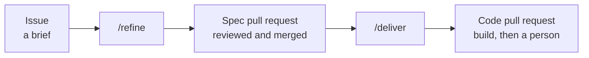

# Governed delivery with Claude Code

A way to have Claude Code build changes while people stay in charge of what is built. A brief starts as a
GitHub issue. `/refine` turns it into a specification with the person who raised it, and a pull request
approves it. `/deliver` then builds it test first, has it reviewed independently, and hands back a pull
request for a person to merge.



Nothing is built until its specification is merged, and a person merges the result. Both steps run on
GitHub, started by a label, or on your own machine under your Claude subscription.

## What a project needs

- [OpenSpec](https://github.com/Fission-AI/OpenSpec), pinned, for the specifications
- a `build.sh` that runs everything that must pass before a commit
- changes named after their issues, such as `57-bank-holidays`
- tests that name the scenario they cover
- on GitHub, the Claude GitHub app and an API key

## Getting started

```bash
git clone https://github.com/dibbdob/claude-code-governed-workflow.git
cd claude-code-governed-workflow
scripts/setup-machine.sh --plugin     # this machine: the tools, and the plugin
scripts/adopt.sh ../your-project      # your project: everything else
```

[Setting up](docs/guide/setting-up.md) covers what to fit afterwards and what to set on GitHub.

## Your first change

1. Write the issue in plain words. Add the `refine` label, or run `/refine 57` in a session.
2. Answer Claude's questions, review the spec pull request, and merge it. The issue is now `ready`.
3. Add the `deliver` label, or run `./scripts/agent.sh 57`.
4. Read the pull request, starting with anything marked *Changed since approval*, and merge it.

## More

- [Refining](docs/guide/refining.md) and [delivering](docs/guide/delivering.md): the steps, and what to check
- [Reference](docs/guide/reference.md): labels, models and switching, troubleshooting
- [How it works](docs/how-it-works.md): what you can rely on, how it is tested, and the repository layout
- [Decision records](docs/adr): why each part is built as it is
