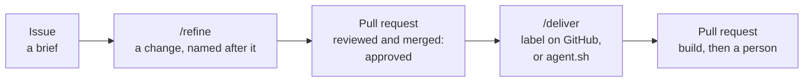

# Governed delivery with Claude Code

A way of working with Claude Code for teams that want it to deliver changes, but want a person to agree what
is built and to approve what is merged. A brief starts as a GitHub issue. `/refine` turns it into a
specification with the person who raised it, reviewed as a pull request. Once that is merged, `/deliver`
builds it test first on a branch of its own, has it reviewed independently, and hands back a pull request for
a person to merge. It runs on GitHub with a label, or on your own machine under a Claude subscription.

Specifications are [OpenSpec](https://github.com/Fission-AI/OpenSpec) changes. This repository includes a
small example to work on, a support desk's rules for a ticket's priority and response deadline, and the
scripts to set the workflow up in a project of your own.

## How a change gets made



The person who raised the issue needs to know nothing of OpenSpec, git or the code: `/refine` asks them about
the product, above all for worked examples, and writes the specification from their answers. Merging its pull
request approves it, and the issue is labelled `ready` with a summary of what was agreed. `/deliver` then
reads the specification through two read-only subagents, writes a failing test for each scenario before the
code, has the work reviewed, archives the change, and writes the pull request description, listing first
anything it reworded since approval.

The [guide](docs/guide/README.md) covers each step: [refining](docs/guide/refining.md),
[delivering](docs/guide/delivering.md), [models and costs](docs/guide/models-and-costs.md),
[setting up](docs/guide/setting-up.md) and [when something goes wrong](docs/guide/troubleshooting.md).

## What you can rely on

- **Nothing is built until its specification is approved.** `/deliver` refuses a change that is not on
  `main`, and only a merged pull request puts it there. There is no flag to set by hand.
- **The tests come from the specification.** Every scenario carries worked examples, and the build fails
  when a scenario has no test naming it ([ADR 0007](docs/adr/0007-a-scenario-is-an-outline-with-worked-examples.md)).
- **The reviewer cannot be talked round.** It is given one commit and the tests, never the author's reasons,
  and a hook holds it to read-only commands ([ADR 0003](docs/adr/0003-the-reviewer-is-not-told-why.md),
  [ADR 0004](docs/adr/0004-a-restriction-is-a-tool-list-or-a-hook.md)).
- **A delivery cannot skip a step.** Reading, review and verification are tasks in every change, and a change
  archived with one undone fails the build ([ADR 0009](docs/adr/0009-a-deliverys-steps-are-tasks.md)).
- **A reworded requirement is never quiet.** It is listed first in the pull request, and noted on the issue,
  for the person who asked for it to confirm.
- **A person merges.** Sessions are denied `git push`, and on GitHub a ruleset makes a pull request
  with a passing build the only way into `main`, merged by a person.
- **Spending is capped.** A run on GitHub stops at $1.50 or 60 turns, and only someone who can label issues
  can start one.

Where an instruction to Claude could be ignored, something else enforces it: a tool list, a hook, or the
build ([ADR 0001](docs/adr/0001-a-rule-points-at-what-enforces-it.md)).

## What it costs, and what it asks of a project

A small change delivered on GitHub on Claude Sonnet 5.5 has cost $0.29 to $0.70, and a refinement on GitHub
about $0.27. On your own machine under a Claude subscription, runs draw on the plan's allowance instead. The
[costs page](docs/guide/models-and-costs.md) lists every run.

In return, a project needs:

- **OpenSpec**, pinned, for its specifications;
- **a `build.sh` that is the whole gate**, which the workflow runs before every commit;
- **changes named after their issues**, such as `57-bank-holidays`;
- **tests that name the scenario they cover** in their title;
- on GitHub, **the Claude GitHub app and an API key**, from an account with a spend limit.

## Getting started

```bash
git clone https://github.com/dibbdob/claude-code-governed-workflow.git
cd claude-code-governed-workflow
scripts/setup-machine.sh --plugin          # this machine: the tools, and the plugin
scripts/adopt.sh ../your-project           # your project: everything else, ready to fit
```

[Setting up](docs/guide/setting-up.md) says what each does, what to fit afterwards, and what to set on GitHub.

To work on this repository itself, you need Node 22.12 or later and Python 3, and
[actionlint](https://github.com/rhysd/actionlint) for the workflow check (`brew install actionlint`). Then:

```bash
./build.sh
```

The build is the whole gate: OpenSpec's validation, scenario coverage, the delivery tasks, the tests, the
plugin matching `.claude/`, every relative link, the GitHub workflows and the hook's tests. Without
actionlint, a build on your machine says the workflows were NOT CHECKED and carries on; on GitHub it fails.

## How well it is tested

- **By the build,** on every pull request: every gate, each shown failing on a planted breach before it was
  trusted, the hook's allow and refuse lists, and the scripts against stand-ins for `claude` and `gh`.
- **On live runs:** eight changes taken from an issue to a merged pull request, on GitHub and on a laptop;
  `/refine` both on GitHub and in a session; a requirement reworded during a delivery and flagged for
  confirmation; and the plugin installed in another repository, its hook refusing writes.
- **Not yet run:** `/refine` with an author other than the developer; OpenSpec's `explore` skill; the
  question an attended delivery asks before archiving a reworded change; and a delivery's pull request
  closing its issue on merge.

The [record](docs/record.md) lists each run as it happened, with its cost and the faults it found.

## Layout

```
.claude/
  agents/        spec-reader, independent-reviewer
  commands/      deliver, refine
  hooks/         read_only_bash.py and its tests
  skills/        links to OpenSpec's skills
  settings.json  permissions
.agents/skills/  OpenSpec's skills, shared by any AI tool (generated by openspec init and update)
docs/guide/      how to refine, deliver and set up
docs/adr/        why each decision was made
docs/record.md   every run, as it happened
openspec/
  specs/         how the system works now, requirement by requirement
  changes/       approved changes still to deliver, and archive/ for delivered ones
.github/         the build check, the ready label and issue summary, and refinements and deliveries
                 started by a label
plugin/          a marketplace with one plugin, generated from .claude/
scripts/         agent.sh runs a delivery unattended; refinement.sh publishes a refinement;
                 headless-tools.txt and refine-tools.txt, what each may use on its own;
                 setup-machine.sh and adopt.sh set up a machine and another project
src/, test/      the example: a support desk's rules, their tests and worked examples
tools/           specs.mjs, links.mjs, issue-summary.mjs, package_plugin.py, and the stand-in claude
                 and gh for tests
build.sh         the gate
```
