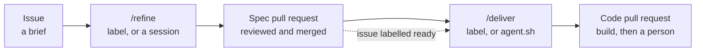

# Refining and delivering a change

A guide for developers, and for the people who write specifications with them, to `/refine` and `/deliver`:
how an issue becomes an approved specification, and how that specification becomes a reviewed pull request,
on GitHub with a label or on your own machine under a Claude subscription.

1. [Refining a change](refining.md): `/refine` on GitHub or in a session, and what to check before approving
2. [Delivering a change](delivering.md): what `/deliver` does, on GitHub or on your machine, and what to
   check in its pull request
3. [Models](models.md): which model does what, and how to switch
4. [Setting up](setting-up.md): each machine, each project, and GitHub
5. [When something goes wrong](troubleshooting.md)

Why each part is built as it is: the [ADRs](../adr).

## In plain terms

`/refine` turns a GitHub issue into a specification with the person who raised it, who needs to know nothing
of OpenSpec, git or the code. It ends in the specification's own pull request, and merging that pull request
is the approval.

`/deliver` builds an approved change on a branch of its own. It writes a failing test for each scenario
before the code, has the work checked by a reviewer that is never told the author's reasoning, and stops at a
pull request description. A person always opens and merges the pull request.

Both run in two places, with the same command, tools and turn limit in each:

- **On GitHub**, by a label on the issue. Anthropic's Claude Code action does the work on GitHub's machines,
  paid for by the repository's API key.
- **On your machine**, under your own Claude login. With a subscription, that uses the plan's allowance
  rather than API credit.

## How a change gets made



The specification is an [OpenSpec](https://github.com/Fission-AI/OpenSpec) change: a folder holding a
proposal, a task list, and requirements with scenarios. It is named after its issue, as
`<issue>-<what-it-does>`, for example `57-bank-holidays`. That name is how a delivery finds it.

| Stage | Who | What is true when it ends |
|---|---|---|
| Issue | Anyone | A brief exists: the problem, who it affects, what good looks like. |
| Refine | The spec author, with `/refine` | A change folder sits on a `refine/…` branch, with plain terms, a risk level, scenarios with the author's worked examples, and tasks. Its spec pull request is open. |
| Spec pull request | A reviewer, usually the developer | The change is merged to `main`, which approves it. The issue is labelled `ready`, with a summary of the change below the brief. |
| Deliver | The issue's assignee | A `deliver/…` branch holds tests, code and the archived change, and a pull request description. |
| Code pull request | A person | The build passed and someone reviewed and merged it, which closes the issue. |

**The rule that holds the rest together:** a change on `main` is approved; a change anywhere else is still
being refined. `/deliver` refuses a change that exists only on someone's branch, and there is no field anyone
can set by hand to say otherwise.

## Labels

| Label | Set by | What it does |
|---|---|---|
| `refine` | The spec author, or anyone with triage rights | Starts a refinement on GitHub: Claude drafts the change from the issue and the spec pull request is opened. The conversation carries on there, in comments that mention `@claude`. Each run spends API credit. Not needed for a refinement in a session. |
| `ready` | The `refined` workflow, automatically | The change is approved: its `proposal.md` has landed on `main`. Do not add it by hand: it would claim an approval that has not happened, and a delivery would still refuse to start. |
| `deliver` | Anyone with triage rights | Starts a delivery on GitHub. It spends API credit, so **who may add labels is who may spend**. Add it only to an issue labelled `ready`. |
| `bug`, `enhancement` | The issue's author | GitHub's own. They start nothing. For a bug, the proposal should say it fixes a defect, which makes `/deliver` commit a failing test that reproduces it before any fix. |

The spec pull request says `Refines #n`, so approving it leaves the issue open; the code pull request says
`Closes #n`, so merging it closes the issue. To run a GitHub delivery again, remove `deliver` and add it back:
the workflow listens for the label being added. Labels do not assign work (the issue's assignee has it, and
nothing warns two people who start the same change) and do not mark progress, which shows in the action's
comment and the branch.

## Quick reference

```text
Spec author                              Developer
-----------                              ---------
On GitHub: add the refine label, then    On GitHub: add the deliver label
answer on the spec pull request:
  @claude Q1 yes. Q2 the 5th, not 1st.   On your plan, unattended:
                                           ./scripts/agent.sh 57
In Claude Code, on your plan:              ./scripts/agent.sh 57 --model claude-opus-5-5
  /refine 57
Run it again to answer review comments.  On your plan, attended:
                                           git switch -c deliver/57-bank-holidays
                                           /deliver 57-bank-holidays   (in a session)
```

| File | What it holds |
|---|---|
| [`refine.md`](../../.claude/commands/refine.md), [`deliver.md`](../../.claude/commands/deliver.md) | The two commands |
| [`spec-reader.md`](../../.claude/agents/spec-reader.md) | The reading subagent: Haiku, no shell |
| [`independent-reviewer.md`](../../.claude/agents/independent-reviewer.md) | The reviewer: the session's model, held read-only by a hook |
| [`delivery-model.txt`](../../scripts/delivery-model.txt) | The default model, for GitHub and `agent.sh` |
| [`headless-tools.txt`](../../scripts/headless-tools.txt), [`refine-tools.txt`](../../scripts/refine-tools.txt) | The tools an unattended delivery, or a refinement on GitHub, may use |
| [`agent.sh`](../../scripts/agent.sh), [`refinement.sh`](../../scripts/refinement.sh) | A delivery unattended on your machine; a refinement started and published from a session |
| [`setup-machine.sh`](../../scripts/setup-machine.sh), [`adopt.sh`](../../scripts/adopt.sh) | Setting up a machine, and another project |
| [`.github/workflows/`](../../.github/workflows) | `refine`, `refined`, `deliver`, `revised` and the build |
| [`openspec/config.yaml`](../../openspec/config.yaml) | The rules for risk, scenarios, tasks, building and archiving |
