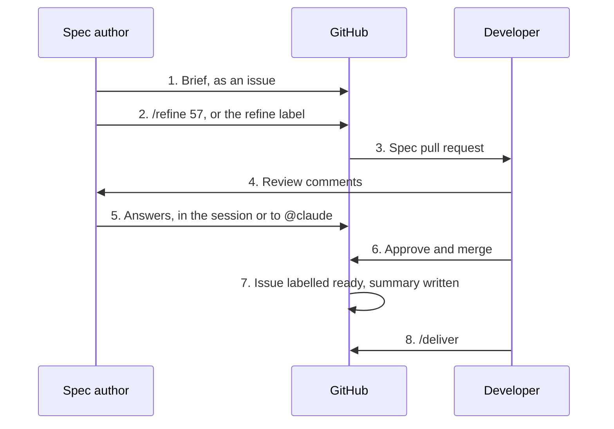

# Refining a change

A common shape: someone on the business side knows what the product should do, and a developer delivers it.
The specification is refined and approved before the developer takes it on. `/refine` hides the machinery:
the author needs to know nothing of OpenSpec, Gherkin, git or the code. They answer questions about the
product and, above all, give worked examples.

Refinement ends in the specification's own pull request. The author proposes, the developer reviews, and the
merge is both the approval and the handover.



## What `/refine` does

The command is [`refine.md`](../../.claude/commands/refine.md); the reasons are in
[ADR 0010](../adr/0010-refinement-is-a-command-too.md).

| # | Step | What happens |
|---|---|---|
| 0 | Gates | The issue exists and is not already approved. In a session, `scripts/refinement.sh start` puts the checkout on `main` for a new refinement, or on the issue's `refine/` branch for a revision, and refuses uncommitted work. |
| 1 | Understand | Reads what the product does now in that area, then asks a few numbered questions at a time: who it is for, what should be true afterwards, **three to six worked examples, including the awkward one**, what should not change, and why it matters. It proposes cases and asks the author to correct the answers. It writes nothing yet. |
| 2 | Write the change | Names it `57-bank-holidays` and runs OpenSpec's `openspec-propose`. The project's rules reach it automatically: the proposal opens with *In plain terms* and ends with *Risk*, every scenario is an outline with the author's examples, and the tasks end with the Delivery group. No code and no tests. |
| 3 | Check it builds | Runs `./build.sh` and fixes anything of form, so the spec pull request does not arrive failing. |
| 4 | Revise | On a later run, reads the author's answers and the reviewer's comments and revises with `openspec-update-change`. Where a reviewer contradicts the author, it asks the author rather than choosing. |
| 5 | Hand over | Reads the change back in plain terms (what will be true, the examples, the risk, the open questions), writes the pull request description and publishes it. It never approves or merges. |

## Two ways to run it

| | In a session, on the author's plan | On GitHub, with the `refine` label |
|---|---|---|
| The author needs | Claude Code (the desktop app's Code tab is enough) and a checkout, set up once with [`setup-machine.sh`](setting-up.md) | A browser, and write access to the repository |
| Feels like | A conversation | Taking turns in comments, minutes per reply |
| Who pays | Their subscription | The repository's API key, every reply |
| Record kept | What ends up in the specification | The whole conversation, in the pull request |
| Best for | Regular authors, much back and forth | Occasional authors, small changes |

The two can be mixed: a refinement started with the label can be carried on in a session, and the other way
round.

### In a session

```text
/refine 57
```

The author answers as they go and can ask for changes before anything is published. Publishing is one
script: `scripts/refinement.sh publish 57` commits only the change folder, runs the build, pushes the
`refine/57-…` branch, opens the spec pull request and links it on the issue. Sessions are denied
`git push`, so the script is the one way a refinement leaves the machine, and it refuses if anything outside
the change folder has changed. To answer review comments, run `/refine 57` again; the script finds the
existing branch, including one started on GitHub, and updates the open pull request.

### On GitHub

Nobody talks to Claude live. Each turn is a separate run that reads the whole thread again, so the thread is
the conversation's memory.

1. The author writes the issue in plain words and adds the `refine` label.
2. Claude drafts the change from the issue alone. Since nobody can answer it, it writes each assumption down
   and numbers its questions.
3. The workflow opens the spec pull request and links it on the issue. Claude's comment holds the plain-terms
   read-back and the questions.
4. The author answers on the pull request, mentioning `@claude`:
   *"@claude Q1 yes. Q2 bank holidays count as closed days. The 17:45 example is right."* Each such comment
   is another run, which revises the change on the same branch and replies with what changed and what is
   still open.
5. The developer reviews in the same thread, and can mention `@claude` too, then approves and merges.

Only comments on a pull request whose branch starts `refine/` start a run, and comments by bots start none.
The action answers only people with write access. Each run is capped at $1.00 and 40 turns.

## What the developer checks before approving

| Check | What good looks like |
|---|---|
| The intent is clear | *In plain terms* says what will be true afterwards, in words the product's users would recognise, and what is out of scope. |
| The risk is stated | Low, medium or high, with a reason. Medium or high has a design whose risks each have a mitigation a test or the reviewer can check, and a task for it. |
| The examples are the author's | Real values and answers the author has seen, not ones Claude invented. Claude flags any example it added itself; check the author has agreed to each. On the first refinement, two flagged examples went into the approved change because nobody answered the flag. |
| The awkward case is there | The boundary easiest to get wrong has its own row. Asking for it now is cheaper than in delivery. |
| No open questions | The description's *Open questions* says "None". A question left open is decided by whoever delivers it. |
| It builds | The `build` check passes, and nothing assumes code that does not exist. |

## After the merge: the summary on the issue

When the change lands on `main`, the `refined` workflow labels the issue `ready` and writes a summary of the
change below the original brief, which stays as it was. The summary is taken from the change, so it adds no
wording of its own:

```markdown
## Refined: approved 15 Nov 2026

**In plain terms:** A ticket opened on a bank holiday is due as if it were opened at 09:00 on the next
working day.

**Examples agreed**
| opened                     | due                        |
| Fri 25 Dec 2026, 10:00 UTC | Mon 28 Dec 2026, 13:00 UTC |

**Risk:** Medium. It changes deadlines customers see.
**Specification, as approved:** <link to the change at the approving commit>
**Refinement discussion:** #61
```

Approving again replaces the summary rather than adding a copy. If a delivery later rewords a requirement,
the `revised` workflow adds a line pointing at the code pull request's *Changed since approval*, so the issue
never quietly claims the approved wording is current.

Once merged, the developer builds to the specification and does not renegotiate it. A requirement may be
reworded during delivery only while its intent holds, and every rewording is listed first in the code pull
request: **the author should read that section** before it merges. If the intent would change, delivery stops
and a new issue is refined.
